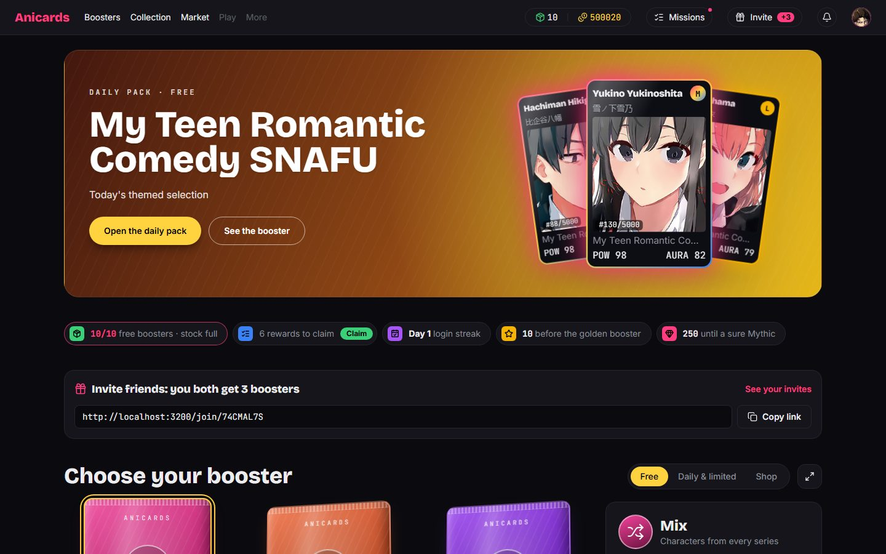
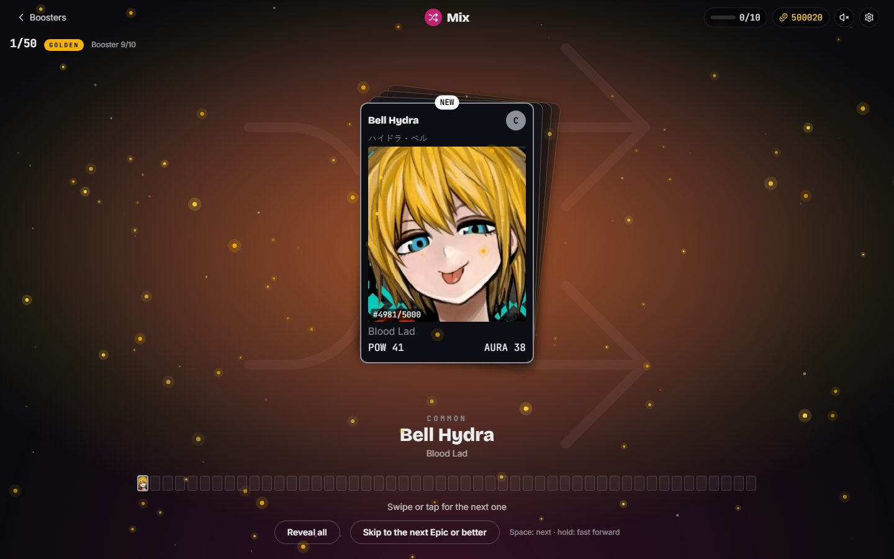
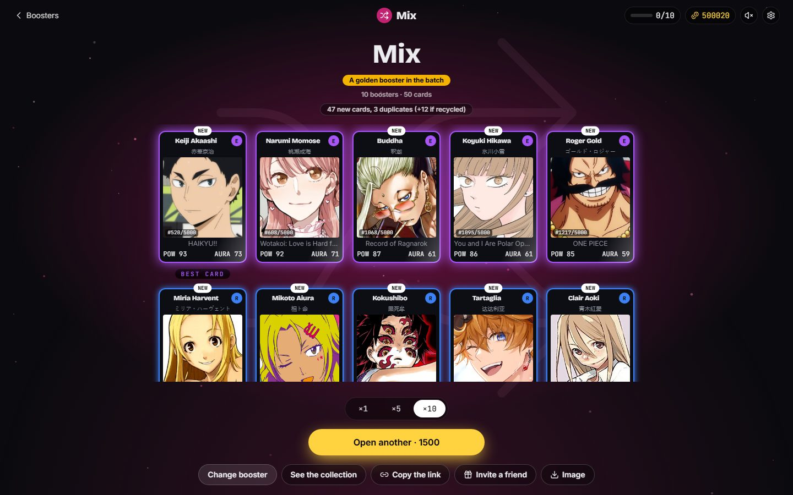
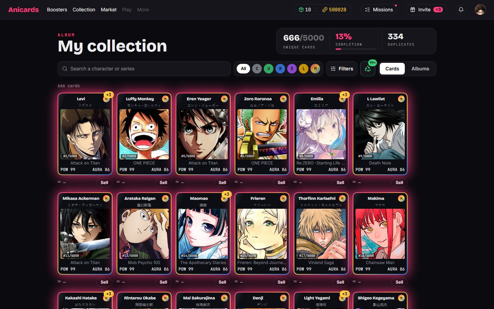
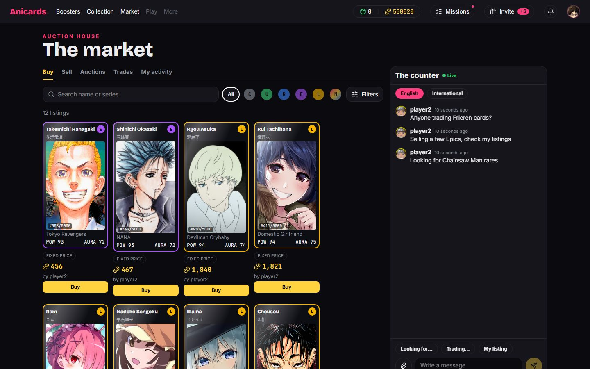
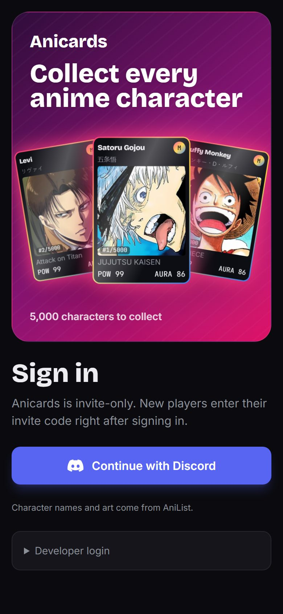
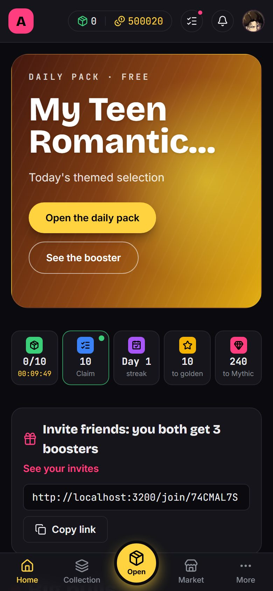
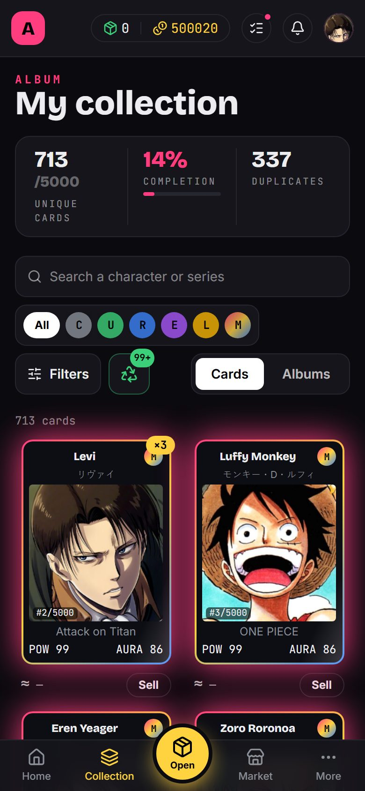

# Anicards

**Collect every anime character. Trade the ones you don't need.**

Anicards is an invite-only card game for a group of friends. Open free boosters (one more every 10 minutes), reveal 5,000 anime characters from the least to the most rare, complete an album for every series, and buy, sell, auction and trade cards on a live market with chat.



## Features

- **Boosters**: free boosters that refill over time, themed and daily packs, shop boosters, a guaranteed Mythic within 250 and a golden booster every 10th
- **Opening**: tear the pack, then flip the cards one by one with rarity glows and sound; open ×1, ×5 or ×10 and share the result as an image
- **Collection**: an album per series with completion, a wishlist, and duplicates recycled into currency
- **Market**: fixed-price listings, auctions, buy orders and trade offers, with escrow, live updates and a chat
- **Social**: public profiles with a showcase, friends, direct messages and personal invite links that reward both players
- **Progression**: a login streak, daily and weekly missions, achievements and seasonal boosters
- **Admin page**: invite codes, currency gifts, daily pools, seasonal boosters and chat moderation
- **Installable app**: works as a PWA on your phone

| Opening | Result |
| --- | --- |
|  |  |

| Collection | Market |
| --- | --- |
|  |  |

<p align="center">
  
  
  
</p>

## Tech stack

Next.js 16 (App Router) · React 19 · TypeScript · Tailwind CSS v4 · next-intl · Supabase (Postgres, Auth, Realtime, pg_cron) · Vitest · Playwright

Every game action is a Postgres function that runs in one transaction and writes to an append-only ledger; the browser never writes game tables directly.

## Getting started

Needs Node.js 20+ and Docker Desktop for the local Supabase stack.

```bash
npm install
npx supabase start
# copy .env.example to .env.local and fill in the keys from `npx supabase status`
npm run catalog:dev   # import the 5,000-card catalog from AniList
npm run invite        # print an invite code
npm run dev
```

Open [http://localhost:3000](http://localhost:3000), sign in, enter the invite code and pick a username. Make yourself admin with `npm run admin -- <username>`.

To put it online, follow [docs/DEPLOY.md](docs/DEPLOY.md).

### Environment variables

| Variable | Purpose |
| --- | --- |
| `NEXT_PUBLIC_SUPABASE_URL` | Supabase project URL |
| `NEXT_PUBLIC_SUPABASE_ANON_KEY` | Supabase anon key |
| `SUPABASE_SERVICE_ROLE_KEY` | Service role key, used only by the local scripts |
| `NEXT_PUBLIC_DEV_LOGIN` | `true` shows the email login for local development |
| `DEV_TEST_EMAIL` / `DEV_TEST_PASSWORD` | Test player used by the phone-width check |

## Scripts

| Command | Description |
| --- | --- |
| `npm run dev` | Start the dev server |
| `npm run build` | Production build |
| `npm run catalog:dev` | Reset the database and import the real catalog |
| `npm run import` | Add new characters to the catalog (never changes existing cards) |
| `npm run invite` | Create an invite code |
| `npm run admin -- <username>` | Make a player admin |
| `npm run test:db` | Database tests (run `npm run db:reset` first, then `catalog:dev` after) |
| `npm run test:ui` | Component and unit tests |

## Credits

Character names and images come from [AniList](https://anilist.co) and are used for a private, non-commercial game. Images are linked, not re-hosted.
